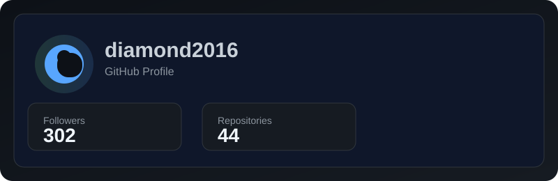

## Hi, I'm diamondnet (Richard G) 👋

I build practical software, APIs, and web experiences with a strong focus on Java, Spring Boot, Vue.js, and FastAPI/Python.

Freelance, open to contributions, and common projects.

You can find my cv at [Linkedin - Riccardo Corsi](https://www.linkedin.com/in/riccardo-corsi-96753150)

## Portfolio

A place where I turn ideas into useful tools, clean interfaces, and reliable backend systems. 

## Tech Stack

## About Me

- Backend-focused developer with strong experience in Java and Spring Boot
- Frontend work with Vue.js to create clean and usable user interfaces
- Also building APIs and automation services with Python and FastAPI
- Passionate about clean architecture, maintainable code, and real-world problem solving
- Interested in product thinking, system design, and creating useful tools

I am currently exploring world of agentic programming and workflow.

## Featured Projects

### 130_sort_visualizer
An interactive sorting visualizer to explore algorithm behavior and performance visually.

- Repo: https://github.com/diamond2016/130_sort_visualizer

### TEA5767sk
A radio-related project focused on hardware/software exploration and practical integration.

- Repo: https://github.com/diamond2016/TEA5767sk

### web_event_clock
A web project focused on event and time-related visualization and utility use cases.

- Repo: https://github.com/diamond2016/web_event_clock

### RadioChWeb
A web-based project related to radio and channel browsing/visualization.

- Repo: https://github.com/diamond2016/RadioChWeb

### Mathematical methods: a journey

- Repo: https://github.com/diamond2016/mathematical-methods-journey

A journey on complex analysis seen from an IT engineer.

Last commit: week02 / roots of unity

## GitHub Stats

## Connect

- GitHub: https://github.com/diamond2016
- Email: diamondnet@outlook.it

> I like building software that is useful, clean, and efficient.
> I care about strong backend logic, intuitive interfaces, and solutions that work in the real world.

## Current Focus

I am currently exploring diffusion models and TTS models for image and audio production. All integrated in Spring Ai apps.

*This image was created by `stable-diffusion-xl` (sdxl) with Spring Ai and Spring OpenaAi interface (ImageModel)*.

